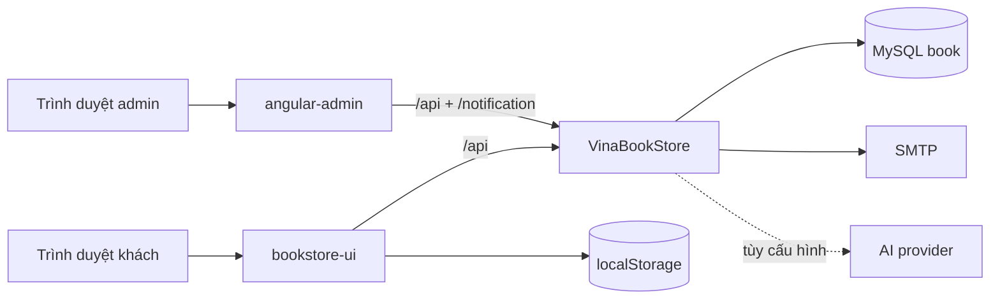

# Kiến trúc VinaBook

## Chatbot hiện tại — Tools v4 (2026-09-11)

Runtime dùng registry `ChatTool` tự mô tả chức năng cho model; orchestrator kiểm tra kế hoạch tối đa ba bước. State RAM có giới hạn theo principal/session; lọc catalog trước khi giới hạn kết quả. Narrator chỉ bổ sung giải thích cho dữ kiện đã kiểm tra. Xem [hướng dẫn mở rộng Tools v4](chatbot-tools-v4.md). Ngữ cảnh công khai có thể tồn tại qua reload, không lẫn bản nháp/địa chỉ của các tài khoản. Chi tiết retention, retry, quote/confirm và giới hạn triển khai tại [chatbot.md](chatbot.md#dialogue-v3--kiến-trúc-đang-dùng-2026-09-10). Các mô tả không lưu nội dung bên dưới nói về telemetry/database; không áp dụng cho state RAM ngắn hạn mới.

## Sơ đồ tổng thể



## Storefront

Storefront là một `AppModule` eager-loaded. Routes ánh xạ tới `pages/`; header, footer, product card và chatbot nằm trong `components/`; guard/interceptor nằm trong `core/`; toast/directive nằm trong `shared/`.

`ProductService.getProducts()` tải `GET /api/products` một lần và cache bằng `shareReplay(1)`. `SearchService` lọc trên catalog cache. Category được lọc bằng `categoryId`, không dựa vào tên hiển thị.

`HomepageService` tải cấu hình trình bày từ `GET /api/homepage`. Backend lưu một bản JSON có version mềm trong bảng `homepage_config` (bản ghi id `1`), nhờ đó thêm thuộc tính trình bày không phải đổi nhiều cột. Storefront ghép cấu hình này với catalog/category thật; admin cập nhật cùng nguồn bằng `PUT /api/homepage`.

Giỏ khách dùng localStorage; giỏ tài khoản dùng `CartSyncService` qua `/api/cart/me`. Cache local được nhập một lần theo mã trình duyệt, server giữ revision để phát hiện ghi đè từ thiết bị cũ. Frontend đợi đồng bộ trước khi xác nhận thao tác/checkout; thay đổi xung đột phải tải lại, có bản sao phần chưa đồng bộ. Checkout trang và chat cùng dùng `ChatCheckoutService`: quote → xác nhận → transaction giữ tồn kho và xóa đúng dòng giỏ đã mua.

`ChatbotService` là client mỏng: ưu tiên `POST /api/chat/stream` (SSE), tự hạ xuống `POST /api/chat` khi kết nối không hỗ trợ stream. Toàn bộ phân loại ý định, lọc giá/thể loại/tác giả, xếp hạng catalog, chính sách và fallback nằm ở backend để không có hai nguồn logic lệch nhau. `AiGateway` chuyển contract sang OpenAI Responses, OpenAI-compatible Chat Completions, Gemini hoặc Anthropic. Response có thẻ sách, quick replies và action có kiểu; thao tác thêm giỏ vẫn chạy qua `CartService` và cần xác nhận người dùng.

`ProductService.getPreview()` chỉ tải manifest khi người dùng mở đọc thử. Các ảnh trang được quản trị trong bảng `product_preview_pages`; public API chỉ trả trang của sản phẩm đang hoạt động và đã bật đọc thử. `Book3dViewerComponent` giữ mô hình sản phẩm và tạm dừng render khi dialog đọc thử mở. `BookPreviewReaderComponent` lazy-load engine Paperbound: trang cong hai mặt, state machine điều phối lật/đóng bìa, texture cache giới hạn tám trang, và chế độ đọc 2D dự phòng. Chi tiết tích hợp và kiểm thử nằm trong [paperbound-reader.md](paperbound-reader.md).

Backend chỉ lưu telemetry tối thiểu trong `chat_events`: mã ngẫu nhiên của câu trả lời, mã phiên, intent, provider, fallback, số sản phẩm, độ trễ và feedback. Nội dung câu hỏi/câu trả lời không được lưu. Dashboard admin đọc số liệu tổng hợp qua endpoint chỉ dành cho `ROLE_ADMIN`.

## Backend và bảo mật

Spring Security xác thực JWT stateless. Public gồm đăng nhập/đăng ký, đọc catalog/cấu hình trang chủ và chat hỗ trợ khách. `GET /api/homepage`, `GET /api/chat/status`, `POST /api/chat`, `/api/chat/stream` và `/api/chat/feedback` là public; `GET /api/chat/admin/**`, `PUT /api/homepage` và các endpoint quản trị khác yêu cầu `ROLE_ADMIN`. Endpoint user yêu cầu `ROLE_USER` hoặc admin tùy nghiệp vụ. Chat public có validation và rate limit theo IP. Khi có JWT hợp lệ, chatbot chỉ tra đơn của principal hiện tại, không nhận user ID/email tùy ý từ client.

Đối với user/cart/order/review, backend đối chiếu principal trong JWT bằng `CurrentUserAccess`. ID/email từ request không tự tạo quyền truy cập. Giá dòng hàng được tính lại từ product trong database và order kiểm tra tồn kho trước khi ghi.

`User.password` và reset token là write-only trong JSON. Response đăng nhập không chứa bcrypt hash.

Bản đọc thử không phải DRM: backend chỉ giới hạn 5–20 trang ảnh hoặc văn bản đã duyệt, kiểm tra MIME/URL, yêu cầu `ROLE_ADMIN` cho thao tác quản trị và không bao giờ trả file toàn bộ cuốn sách. Manifest public chỉ chứa đúng số trang admin đã bật, không tự chèn trang đệm. Production phải chạy migration `VinaBookStore/src/main/resources/db/product-preview.sql` trước khi dùng vì JPA production đang ở chế độ `validate`.

## Production

```text
HTTPS origin
├── /                 -> Angular SPA
├── /api/*            -> Spring Boot :8080
└── /notification     -> Spring Boot WebSocket
```

JWT secret, database và SMTP phải được inject qua biến môi trường. CORS không thay thế authorization.

Backend mặc định dùng profile `dev` cho local. Deploy phải bật profile `prod`; profile này yêu cầu credential/URL public qua biến môi trường, tắt SQL log và `open-in-view`, đồng thời chỉ validate schema. GitHub Actions build/test hai ứng dụng Angular và chạy test Spring Boot với MySQL 8 trên pull request/push vào `main`.

## Thiết kế giao diện

Storefront dùng design token chung với theme editorial làm mặc định:

- Be Vietnam Pro cho UI/body, Playfair Display cho tiêu đề lớn;
- nền stone sáng, chữ ink gần đen, accent terracotta;
- radius vừa, border mảnh, shadow tiết chế;
- theme switcher cho phép đổi editorial/ocean/forest/berry và lưu lựa chọn trên thiết bị;
- motion có hỗ trợ `prefers-reduced-motion`;
- control có label/focus/keyboard semantics và ảnh có alt phù hợp.

Bộ skill dành cho trợ lý không nằm trong source runtime; chỉ component/service theme thực sự được Angular sử dụng được giữ lại.

## Đồng bộ giỏ và vòng đời đơn — 11/09/2026

`CartSyncService` và `OrderCancellationService` lấy chủ tài khoản từ JWT, không nhận chủ tài khoản do model chọn. Đơn mới giữ tồn kho ở bước confirm; trạng thái hoàn thành chỉ cộng số bán, không trừ tồn kho lần nữa. Đơn cũ có `stock_reserved=false` giữ hành vi trừ tồn khi hoàn thành. Hủy COD chưa thanh toán, còn chờ xử lý hoàn đúng lượng giữ; đơn đã trả tiền hoặc thanh toán online cần xử lý giao dịch/hoàn tiền riêng.

Production cần schema [cart-checkout-sync.sql](../VinaBookStore/src/main/resources/db/cart-checkout-sync.sql), áp dụng đúng một lần sau kiểm tra schema hiện tại; dev tự cập nhật bằng Hibernate. Bản nháp và memory vẫn ở RAM một instance, hết hạn sau 15 phút với quote; khởi động lại yêu cầu lập lại bản nháp chưa xác nhận. Đơn đã commit có thể tra lại bằng payment reference khi retry token.
