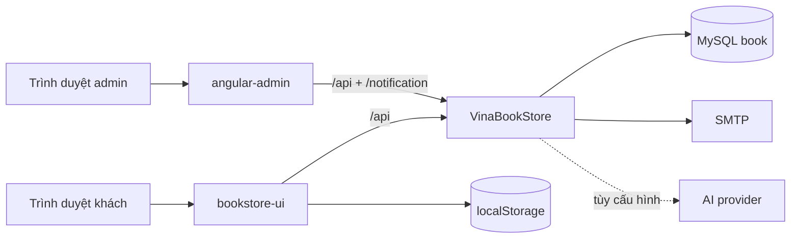

# Kiến trúc VinaBook

## Sơ đồ tổng thể



## Storefront

Storefront dùng `AppModule` và NgModule truyền thống; trang chi tiết sách, nhóm trang khách hàng và widget chatbot tải theo nhu cầu. Chatbot chỉ được tải khi mở hoặc cần khôi phục lựa chọn mua sau đăng nhập. Routes ánh xạ tới `pages/`; header, footer, product card và chatbot nằm trong `components/`; guard/interceptor nằm trong `core/`; toast/directive nằm trong `shared/`.

`ProductService.getProducts()` tải `GET /api/products`, cache bằng `shareReplay(1)` với thời hạn 60 giây và có `refresh()`. `SearchService` lọc trên catalog cache. Category được lọc bằng `categoryId`, không dựa vào tên hiển thị.

`HomepageService` tải cấu hình trình bày từ `GET /api/homepage`. Backend lưu một bản JSON có version mềm trong bảng `homepage_config` (bản ghi id `1`), nhờ đó thêm thuộc tính trình bày không phải đổi nhiều cột. Storefront ghép cấu hình này với catalog/category thật; admin cập nhật cùng nguồn bằng `PUT /api/homepage`.

Địa chỉ, avatar, wishlist và giỏ đồng bộ theo tài khoản; localStorage giữ cache/migration. Cart đổi scope khi tài khoản thay đổi, có revision chống ghi đè. Checkout gửi những dòng được chọn, xác minh lại giá/tồn và giữ nháp riêng trên server qua restart.

`ChatbotService` là client mỏng: ưu tiên `POST /api/chat/stream` (SSE), tự hạ xuống `POST /api/chat` khi kết nối không hỗ trợ stream. Toàn bộ phân loại ý định, lọc giá/thể loại/tác giả, xếp hạng catalog, chính sách và fallback nằm ở backend để không có hai nguồn logic lệch nhau. `AiGateway` chuyển contract sang OpenAI Responses, OpenAI-compatible Chat Completions, Gemini hoặc Anthropic. Response có thẻ sách, quick replies và action có kiểu; thao tác thêm giỏ vẫn chạy qua `CartService`. SSE gửi tiến độ theo giai đoạn và câu trả lời đã kiểm chứng; lỗi Gemini có tư vấn cơ bản bảo thủ dùng cùng công cụ. Client có một deadline chung, worker có giới hạn và hỗ trợ hủy.

`chat_events` lưu telemetry không có nội dung hội thoại. `chat_conversations/chat_exchanges` lưu snapshot và transcript để khôi phục ngữ cảnh, tách scope tài khoản/guest; input nhạy cảm và nội dung hỗ trợ đơn hàng bị loại khỏi transcript chung. Lịch sử phân trang 25 lượt; metrics admin tổng hợp SQL trong khoảng thời gian, mặc định 30 ngày. Retention guest/telemetry cấu hình được và mặc định tắt. Xem [vận hành](operations.md).

## Backend và bảo mật

Spring Security xác thực JWT stateless. Public gồm đăng nhập/đăng ký, đọc catalog/cấu hình trang chủ và chat hỗ trợ khách. `GET /api/homepage`, `GET /api/chat/status`, `POST /api/chat`, `/api/chat/stream` và `/api/chat/feedback` là public; `GET /api/chat/admin/**`, `PUT /api/homepage` và các endpoint quản trị khác yêu cầu `ROLE_ADMIN`. Endpoint user yêu cầu `ROLE_USER` hoặc admin tùy nghiệp vụ. Chat public có validation và rate limit theo IP. Khi có JWT hợp lệ, chatbot chỉ tra đơn của principal hiện tại, không nhận user ID/email tùy ý từ client.

Đối với user/cart/order/review, backend đối chiếu principal trong JWT bằng `CurrentUserAccess`. ID/email từ request không tự tạo quyền truy cập. Giá dòng hàng được tính lại từ product trong database và order kiểm tra tồn kho trước khi ghi.

`User.password` và reset token là write-only trong JSON. Response đăng nhập không chứa bcrypt hash.

Nháp checkout lưu trong DB theo owner và token. Email dùng outbox mã hóa trong cùng transaction nghiệp vụ; worker gửi SMTP riêng, có retry và phục hồi qua restart. ChatBuiltinTools chỉ đăng ký một bộ tool; thao tác khách hàng và phần giải thích sách được tách sang ChatCustomerTools/ChatBookPresenter, dùng chung các guard catalog/tham chiếu.

## Production

```text
HTTPS origin
├── /                 -> Angular SPA
├── /api/*            -> Spring Boot :8080
└── /notification     -> Spring Boot WebSocket
```

JWT secret, database và SMTP phải được inject qua biến môi trường. CORS không thay thế authorization. Profile production tắt SQL log/open-in-view, kiểm tra schema bằng validate. Admin socket dùng vé ngắn hạn từ API đã xác thực, chỉ nhận thông báo do server phát sau commit. Tài khoản khóa không được dùng JWT cũ; reset mật khẩu dùng token hash có hạn và tiêu thụ một lần.

## Thiết kế giao diện

Storefront dùng design token chung với theme editorial làm mặc định:

- Be Vietnam Pro cho UI/body, Playfair Display cho tiêu đề lớn;
- nền stone sáng, chữ ink gần đen, accent terracotta;
- radius vừa, border mảnh, shadow tiết chế;
- theme switcher cho phép đổi editorial/ocean/forest/berry và lưu lựa chọn trên thiết bị;
- motion có hỗ trợ `prefers-reduced-motion`;
- control có label/focus/keyboard semantics và ảnh có alt phù hợp.

Bộ skill dành cho trợ lý không nằm trong source runtime; chỉ component/service theme thực sự được Angular sử dụng được giữ lại.
