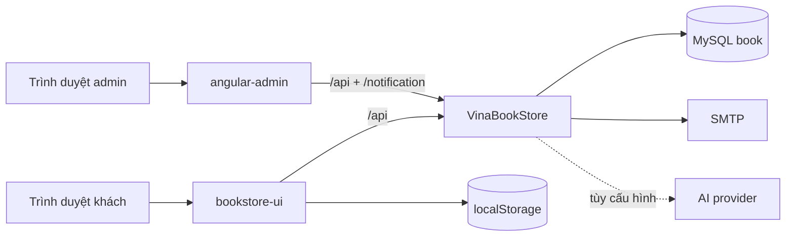

# Kiến trúc VinaBook

## Sơ đồ tổng thể



## Storefront

Storefront là một `AppModule` eager-loaded. Routes ánh xạ tới `pages/`; header, footer, product card và chatbot nằm trong `components/`; guard/interceptor nằm trong `core/`; toast/directive nằm trong `shared/`.

`ProductService.getProducts()` tải `GET /api/products` một lần và cache bằng `shareReplay(1)`. `SearchService` lọc trên catalog cache. Category được lọc bằng `categoryId`, không dựa vào tên hiển thị.

`HomepageService` tải cấu hình trình bày từ `GET /api/homepage`. Backend lưu một bản JSON có version mềm trong bảng `homepage_config` (bản ghi id `1`), nhờ đó thêm thuộc tính trình bày không phải đổi nhiều cột. Storefront ghép cấu hình này với catalog/category thật; admin cập nhật cùng nguồn bằng `PUT /api/homepage`.

Các service state trình duyệt tự hydrate từ `localStorage`. Cart đổi scope khi user hiện tại thay đổi; order service chỉ sync các dòng được chọn sang backend lúc checkout.

`ChatbotService` là client mỏng: ưu tiên `POST /api/chat/stream` (SSE), tự hạ xuống `POST /api/chat` khi kết nối không hỗ trợ stream. Toàn bộ phân loại ý định, lọc giá/thể loại/tác giả, xếp hạng catalog, chính sách và fallback nằm ở backend để không có hai nguồn logic lệch nhau. `AiGateway` chuyển contract sang OpenAI Responses, OpenAI-compatible Chat Completions, Gemini hoặc Anthropic. Response có thẻ sách, quick replies và action có kiểu; thao tác thêm giỏ vẫn chạy qua `CartService` và cần xác nhận người dùng.

Backend chỉ lưu telemetry tối thiểu trong `chat_events`: mã ngẫu nhiên của câu trả lời, mã phiên, intent, provider, fallback, số sản phẩm, độ trễ và feedback. Nội dung câu hỏi/câu trả lời không được lưu. Dashboard admin đọc số liệu tổng hợp qua endpoint chỉ dành cho `ROLE_ADMIN`.

## Backend và bảo mật

Spring Security xác thực JWT stateless. Public gồm đăng nhập/đăng ký, đọc catalog/cấu hình trang chủ và chat hỗ trợ khách. `GET /api/homepage`, `GET /api/chat/status`, `POST /api/chat`, `/api/chat/stream` và `/api/chat/feedback` là public; `GET /api/chat/admin/**`, `PUT /api/homepage` và các endpoint quản trị khác yêu cầu `ROLE_ADMIN`. Endpoint user yêu cầu `ROLE_USER` hoặc admin tùy nghiệp vụ. Chat public có validation và rate limit theo IP. Khi có JWT hợp lệ, chatbot chỉ tra đơn của principal hiện tại, không nhận user ID/email tùy ý từ client.

Đối với user/cart/order/review, backend đối chiếu principal trong JWT bằng `CurrentUserAccess`. ID/email từ request không tự tạo quyền truy cập. Giá dòng hàng được tính lại từ product trong database và order kiểm tra tồn kho trước khi ghi.

`User.password` và reset token là write-only trong JSON. Response đăng nhập không chứa bcrypt hash.

## Production

```text
HTTPS origin
├── /                 -> Angular SPA
├── /api/*            -> Spring Boot :8080
└── /notification     -> Spring Boot WebSocket
```

JWT secret, database và SMTP phải được inject qua biến môi trường. CORS không thay thế authorization.

## Thiết kế giao diện

Storefront dùng design token chung với theme editorial làm mặc định:

- Be Vietnam Pro cho UI/body, Playfair Display cho tiêu đề lớn;
- nền stone sáng, chữ ink gần đen, accent terracotta;
- radius vừa, border mảnh, shadow tiết chế;
- theme switcher cho phép đổi editorial/ocean/forest/berry và lưu lựa chọn trên thiết bị;
- motion có hỗ trợ `prefers-reduced-motion`;
- control có label/focus/keyboard semantics và ảnh có alt phù hợp.

Bộ skill dành cho trợ lý không nằm trong source runtime; chỉ component/service theme thực sự được Angular sử dụng được giữ lại.
