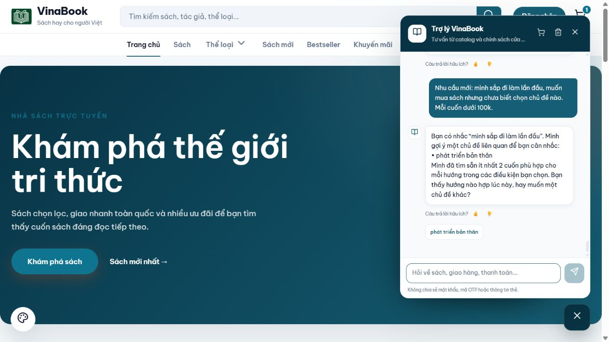

# Chủ đề có sách sẵn và chuẩn bị trước — 11/10/2026

## Hành vi

Khi chưa biết chủ đề hoặc mục đích đọc, chatbot vẫn hỏi để khách chọn hướng. Mỗi lựa chọn được hiển thị phải có ít nhất **2 sách khác nhau** đang bán, còn hàng, đủ bằng chứng nội dung và đáp ứng các điều kiện đang giữ: giá mỗi cuốn, tổng ngân sách đủ mua hai cuốn, rating, nội dung loại trừ, dạng sách và yêu cầu đọc. Có thể hiện 1–3 lựa chọn; không cố thêm chủ đề rỗng cho đủ ba. Nếu chưa có hướng đủ sách, hỏi lại và nói rõ chưa tìm được vài cuốn phù hợp.

AI nhận `catalogTopicHints`: các nhãn chủ đề/thể loại từ hồ sơ đã duyệt có ít nhất hai sách còn hàng. Đây là gợi ý cho bước đọc hiểu, chưa được kiểm tra mọi điều kiện mới trong tin khách. Backend mới quyết định lựa chọn nào được hiện. Nguồn ngữ cảnh vẫn phải là lời khách cụ thể, không phải lời chatbot hay một câu mua sách chung chung.

Backend chạy tìm sách cho từng đề xuất trên **bản sao ngữ cảnh**, dùng cùng `structuredDiscovery` và bộ lọc hiện tại. Với sách có hồ sơ/nhãn đã duyệt, cần nhãn chủ đề/thể loại tương ứng; chỉ nhắc một từ trong mô tả hoặc một nhãn ghép khác nghĩa không đủ. Chẳng hạn `khoa học và tâm linh` không chứng minh sách thuộc chủ đề `khoa học`. Sách chưa có nhãn dùng bằng chứng cụm chủ đề đầy đủ trong dữ liệu catalog. Các hồ sơ/nhãn được đọc theo batch và chỉ giữ trong phạm vi lượt.

Danh sách chuẩn bị lưu riêng theo cuộc hội thoại trong `preparedTopics`: nhãn lựa chọn, bộ điều kiện, các ID đã xếp hạng và mã kiểm tra phiên bản dữ liệu. Thời hạn 5 phút, tối đa 3 chủ đề. Không thêm đề xuất vào bộ lọc đã xác nhận; không thêm sách chuẩn bị vào displayed/shortlist/shownProductIds. Không đưa catalog mẫu vào giao diện.

Khi khách bấm chip, nhập nguyên nhãn hoặc chọn số thứ tự đơn giản, backend xác nhận đúng lựa chọn đã hiện, giữ các điều kiện trước đó và dùng pool đã chuẩn bị. Trường hợp cache hợp lệ dùng câu trả lời backend có mô tả đã xác nhận, bỏ lời gọi AI đọc hiểu và AI viết. Giá, stock và thẻ sách được dựng lại từ catalog hiện tại. Dữ liệu/nhãn/rating thay đổi, thời hạn hết hoặc điều kiện khác thì bỏ cache và tìm lại. Câu chọn kèm yêu cầu mới vẫn qua AI đọc hiểu và các bộ lọc như thường.

## Kiểm thử tự động

**154 kiểm thử / 6 suite, 0 lỗi, 0 bỏ qua**, gồm **22 kịch bản mới**. Kiểm tra ba pool độc lập; một/không có lựa chọn đủ sách; không chạm ngữ cảnh xác nhận/lịch sử đã xem; chọn chip/ordinal không gọi lại AI hoặc xếp hạng truy xuất; biên giá độc quyền; tổng ngân sách; chọn một cuốn dù chủ đề có nhiều sách; điều kiện bổ sung; dữ liệu giá/tồn kho/nội dung/rating/nhãn thay đổi; TTL; serialize/restore; tách cuộc hội thoại; đổi nhu cầu; pool trùng; nguồn nhãn đã duyệt; chuẩn bị không gọi embedding từ xa; sách tâm linh chỉ nhắc khoa học bị loại.

Chi tiết: [suites](catalog-topics-2026-10-11-tests.json), [class kiểm thử trùng runtime](catalog-topics-2026-10-11-runtime.json).

## Thử trực tiếp trên chatbot

10 lượt tự thử trong giao diện localhost:4200, có giữ các kết quả trước khi sửa, không tính lịch sử sẵn có của người dùng. 5 lượt cuối dùng bản đã siết nhãn:

| Lượt | Kịch bản | Kết quả |
|---|---|---|
| P05-final | Chưa biết chủ đề, không giới hạn giá | Hiện ba hướng có sách: truyện để thư giãn, phiêu lưu, trinh thám; không gợi ý khoa học khi chưa đủ hai sách đúng nhãn |
| P06-final | Chọn hướng thứ ba bằng số thứ tự | Đúng hai cuốn Sherlock Holmes và Conan; backend 166ms, giao diện hiện xong 1671ms |
| P07-final | Chưa biết chủ đề, mỗi cuốn dưới 1.000đ | Không tạo lựa chọn thiếu sách; hỏi hướng đọc và nói chưa có vài cuốn phù hợp |
| P08-final | Sắp đi làm lần đầu, mỗi cuốn dưới 100k | Dùng đúng ngữ cảnh, hiện một hướng phát triển bản thân có ít nhất hai sách |
| P09-final | Bấm hướng phát triển bản thân | Sức Mạnh Tiềm Thức 99.000đ và Quẳng Gánh Lo Đi Và Vui Sống 90.160đ; backend 149ms, giao diện hiện xong 1849ms |

Các lỗi phát hiện trước đó và đã sửa: câu “chưa có chủ đề hay mục đích cụ thể” bị cá nhân hóa; chủ đề khoa học nhận cả sách tâm linh chỉ nhắc khoa học; chủ đề thiên văn có thể bị khớp nhầm do từ “văn học” trong kệ. Có kiểm thử hồi quy cho các lỗi này ở phạm vi gợi ý/chuẩn bị chủ đề.

[10 lượt UI gồm trước/sau sửa](catalog-topics-2026-10-11-ui.json) · [Số đo log backend](catalog-topics-2026-10-11-timings.json)

## Giới hạn

Số đo 149–166ms chỉ thuộc hai lượt chọn đơn giản trên máy local, không phải cam kết tốc độ mọi câu chat hoặc benchmark so sánh toàn hệ thống. Lượt đầu hỏi chọn hướng vẫn phải chờ Gemini; ở thử nghiệm cuối mất 6,5–13,5 giây ở backend, trong đó chuẩn bị sách khoảng 0,4–2 giây. Chuẩn bị giúp lượt chọn tiếp theo nhanh hơn, không loại bỏ độ trễ của lượt đọc hiểu đầu tiên.

Nhãn phải được biên tập đúng; khớp nhãn không tự chứng minh một sở thích cá nhân hay độ khó. Bộ lọc hiện tại vẫn có giới hạn ngữ nghĩa. Việc siết nhãn áp dụng cho sách chuẩn bị, không phải một cuộc sửa toàn bộ truy xuất tự do. Topic hints tối đa 60 và ngữ cảnh nguồn tối đa 4 lượt gần nhất. Cache dùng các sách hợp lệ đã chuẩn bị; sách mới được thêm sau đó có thể chỉ xuất hiện khi tìm lại hoặc cache hết hạn. Khi khách cho phép gợi ý gần chủ đề và nhóm đúng chủ đề chưa đủ số cuốn, bước mở rộng có thể cần xử lý thêm.

Đã nạp bản kiểm thử vào backend local; không thay dữ liệu catalog, không commit hoặc push trong công việc này.
