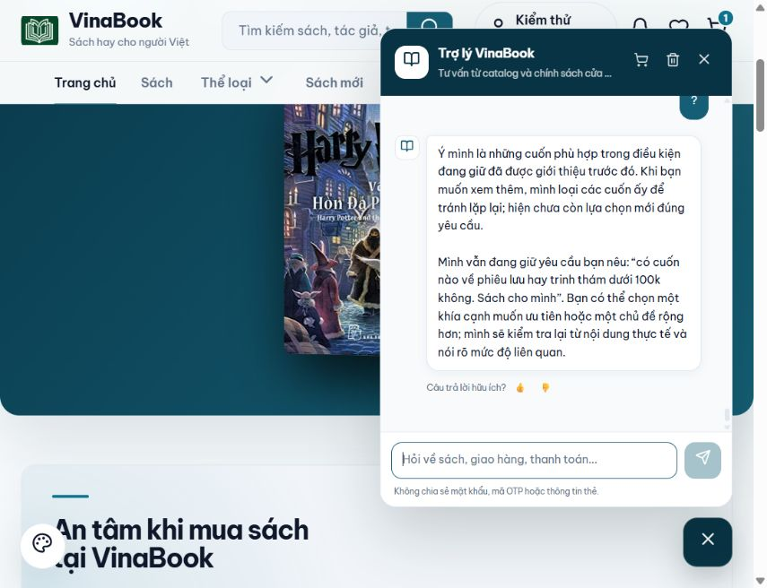

# Sửa ngữ cảnh và tư vấn tự nhiên — 09/10/2026

## Lỗi tái hiện trên phiên khách

“t đang buồn chán bạn có cuốn nào thú vị ko” bị hiểu thành cần xác định một sách; “có cuốn nào về phiêu lưu hay trinh thám gì đó” báo không có sách dù “hoặc” lại có; “?” và “tiếp” quay lại hỏi chủ đề/người nhận. Đọc trực tiếp phiên đang mở trước khi sửa, không xóa lịch sử.

## Bản sửa

Nhận câu hỏi tìm sách tự nhiên, phân biệt lựa chọn OR với tính từ “hay”, bám bộ lọc và loại sách đã xem khi tiếp tục, giải thích câu trước khi khách hỏi lại. Mục đích giải trí chọn tác phẩm kể chuyện có căn cứ về dạng truyện hoặc thể loại; không suy diễn nhẹ nhàng từ buồn chán. Sau câu hỏi chính sách, từ “tiếp” không tự chuyển về sách.

## Kiểm tra

277 test đạt: 11 ChatConversationRegressionTest, 187 ChatToolsTest, 59 ChatServiceTest, 20 ChatRecommendationIntakeTest. Ca mới kiểm tra chuỗi hội thoại thật, giá, OR/AND, sách không lặp, hỏi lại khi không có kết quả, phân biệt hết lựa chọn mới với thiếu bằng chứng về sách, tham chiếu thứ tự, không có ngữ cảnh, đổi sang chính sách, và điều phối tool khi bật đường AI với model được mock.

UI thao tác qua chatbot thật tại localhost:4200, backend provider local. Lịch sử được giữ qua khởi động lại backend. Một gợi ý chiêm nghiệm tâm linh lọt vào lần kiểm tra đầu được phát hiện và sửa thêm bộ lọc bằng chứng dạng truyện. Phần giải thích khi đã hết sách chưa giới thiệu cũng được sửa để nói đúng nguyên nhân; các kết quả này được ghi là REPAIRED, không tính đạt ở bản đầu. Không tạo đơn hoặc sửa giỏ.

| Kịch bản | Kết quả |
|---|---|
| resume-existing-after-restart | PASS — Tiếp tục phiên lỗi gốc sau restart; thêm Dế Mèn và Không Gia Đình, không hỏi lại. |
| boredom-suggestion | REPAIRED — Phát hiện Muôn Kiếp Nhân Sinh lọt vào; sửa bằng chứng dạng truyện và kiểm tra lại. |
| casual-or | PASS — Hiểu hay=OR; Harry Potter, Conan và Dế Mèn đều có nội dung phù hợp. |
| question-follows-answer | PASS — Giải thích danh sách vừa gợi ý; không hỏi lại nhu cầu. |
| more-after-explanation | PASS — Đã hết sách chưa giới thiệu thì báo rõ, không lặp lại. |
| boredom-suggestion-final | PASS — Tác phẩm kể chuyện; không còn Muôn Kiếp Nhân Sinh. |
| or-budget-final | PASS — Conan 23.750đ và Dế Mèn 50.400đ; không đưa sách vượt 100k. |
| short-more-budget-final | PASS — Báo hết lựa chọn mới, không lặp sách hoặc tự nới giá. |
| question-after-empty-final | REPAIRED — Phát hiện giải thích nhầm thiếu dữ liệu khi đã xem hết; sửa và thử lại ở bản cuối. |
| resume-budget-after-final-restart | PASS — Khôi phục ngữ cảnh từ lịch sử; không hỏi lại chủ đề, không tự nới giá. |
| exhausted-books-explanation-final | PASS — Nói đúng đã hết cuốn mới; nhắc lại yêu cầu có dấu và giữ mức dưới 100k. |

Chi tiết phản hồi: [JSON](results-ui-context-repair-2026-10-09.json). Lỗi gốc: [lịch sử trước sửa](context-repair-before-2026-10-09.json).

## Giới hạn

Chưa chạy Gemini thật. Các ca trên xác nhận lỗi cụ thể và hồi quy liên quan, không phải đánh giá mọi cách diễn đạt hoặc mọi sách trong catalog. Câu trả lời cũ trong lịch sử vẫn được giữ nguyên; chỉ các lượt mới chạy quy tắc đã sửa.
