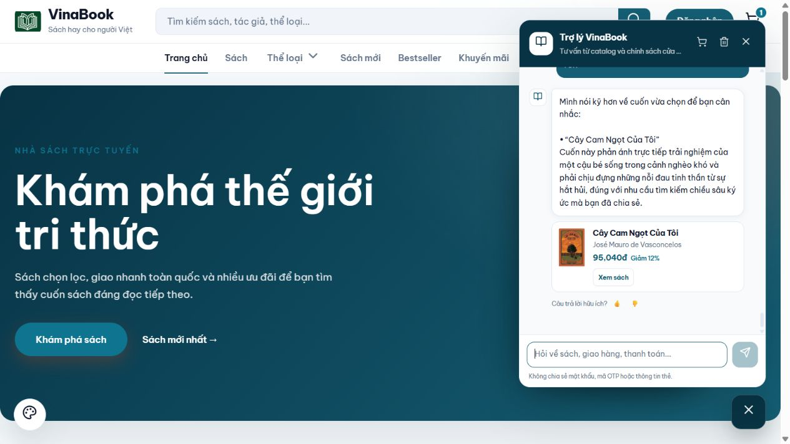

# Thử xếp hạng theo nhóm nhãn — 10/10/2026

## Thay đổi đã chạy local

Giữ nguyên mẫu **20 sách / 154 nhãn**, không nhập thêm nhãn hay sửa catalog. Chỉ bổ sung điểm xếp hạng từ dữ liệu đã duyệt trong `BookKnowledgeService`:

- Chủ đề và mục đích đọc có trọng số cao hơn độc giả và cách trình bày; tên sách và các trường hồ sơ đã duyệt cũng được xét để sách chưa có nhãn mới vẫn có căn cứ cạnh tranh.
- Ưu tiên cụm từ sau chuẩn hóa và mức độ đáp ứng toàn bộ yêu cầu. Khớp vài từ chung của câu dài được giảm ảnh hưởng.
- Trong mỗi nhóm, chỉ lấy nhãn khớp tốt nhất; các nhãn đồng nghĩa hoặc lặp không cộng dồn trong nhóm.
- Chỉ dùng nhãn từ hồ sơ đã duyệt. Đọc liên kết chủ đề và tên chủ đề bằng hai truy vấn theo lô, không truy vấn từng cuốn.
- Các bộ lọc, cách sắp xếp giá do khách yêu cầu, embeddings và thông tin chưa xác nhận giữ luồng xử lý hiện có. Điểm mới là quy tắc xếp hạng thử nghiệm, không phải xác suất phù hợp.

Mã mới nằm ở `BookRelevanceScorer`; phương thức repository đọc liên kết theo danh sách ID dùng Spring Data hiện có. Không thêm dịch vụ ngoài hoặc thay schema.

## Phương pháp đo

Hai nhánh dùng cùng snapshot MySQL, cùng 154 nhãn đã nhập, cùng bộ lọc và danh sách ứng viên. Chỉ thay công thức xếp hạng. Nhánh trước giữ công thức từ khóa cũ được đóng băng trong fixture; embedding tắt ở cả hai nhánh, không gọi nhà cung cấp AI. Phép đo gắn nhãn cũ vẫn tái lập đúng toàn bộ các số liệu đã báo cáo.

Trước khi sửa mã, đã chốt 30 câu diễn đạt mới và 8 câu kiểm tra sách chưa gắn nhãn. Người viết đã xem hồ sơ/nhãn; đây **không phải tập đánh giá mù hoặc đại diện thống kê**. Bộ sách liên quan toàn catalog có thể chưa liệt kê hết mọi lựa chọn hợp lý. Các câu hỏi và đáp án không sửa sau khi xem kết quả.

SHA-256 bộ câu mới: `d1414c846e4165b4973871fff06a2722fb9675bdfb4d11e429d4f1218dd1827d`.

## Kết quả truy xuất

| Bộ câu và phạm vi ứng viên | Đúng ở vị trí đầu trước → sau | Trong 3 vị trí đầu trước → sau |
|---|---:|---:|
| 30 câu cũ, mẫu 20 sách | 27 → **30** | 30 → 30 |
| 30 câu mới, mẫu 20 sách | 26 → **28** | 28 → 29 |
| 30 câu cũ, toàn bộ 56 sách | 27 → **30** | 30 → 30 |
| 30 câu mới, toàn bộ 56 sách | 26 → **28** | 28 → 28 |
| 8 câu kiểm tra sách ngoài mẫu, toàn bộ 56 sách | 8 → **8** | 8 → 8 |

Không có câu nào đang đúng ở vị trí đầu thành sai trong kết quả cuối. Có 128 cặp truy xuất trước/sau; không coi các nhóm trùng câu hỏi là 128 câu độc lập.

[Toàn bộ thứ hạng và sách kỳ vọng](ranking-20-ab-2026-10-10.json) · [Bộ câu hỏi mới cố định](ranking-novel-2026-10-10.json).

Lần đầu, trọng số nhãn sửa được ba câu cũ nhưng làm “truyện tuổi thơ nỗi đau” đưa sách chỉ khớp tuổi thơ lên đầu. Đã bổ sung điểm bao phủ toàn yêu cầu và test hồi quy cho tình huống này. Sau đó chạy lại, cả 30 câu cũ đạt vị trí đầu; không đổi nhãn hay đáp án để đạt kết quả.

## Hai câu mới còn yếu

- **H05 — “truyện về trẻ em và môi trường học”**: Totto-chan bị loại trước khi xếp hạng. Bộ lọc hiện có dùng các cụm trẻ em/thiếu nhi khá cứng và chưa phân biệt tốt “nội dung kể về trẻ em” với “sách dành cho trẻ em”. Thêm điểm xếp hạng không khôi phục được sách đã bị loại.
- **H06 — “cuộc sống ở trường của cô bé”**: Totto-chan có trong ứng viên nhưng Hoàng Tử Bé vẫn đứng đầu. Các từ chung về cuộc sống và “bé” còn gây nhiễu. Totto-chan lên vị trí 3 trong mẫu 20, vị trí 5 trong catalog 56; chưa đủ để coi là tư vấn đúng.

Đây là kiểm thử truy xuất trực tiếp, chưa qua bước AI diễn giải câu hỏi. Luồng chatbot thật có thể thành công hoặc thất bại khác với hai trường hợp trên.

## Kiểm tra mã và dữ liệu

**71 test đạt, 0 lỗi, 0 bỏ qua**: 11 `BookKnowledgeServiceTest`, 7 `BookRelevanceScorerTest`, 1 `BookFacetRankingEvaluationTest`, 3 `BookLabelPilotEvaluationTest`, 7 `ChatExplicitFiltersTest`, 42 `ChatStructuredPipelineTest`.

Kiểm tra gồm: ưu tiên chủ đề so với chi tiết độc giả; cụm từ so với từ rời; nhãn lặp và alias không cộng dồn; hồ sơ chưa duyệt không làm căn cứ; yêu cầu có điều kiện bổ sung không bị khớp một phần lấn át; truy vấn chủ đề theo lô chỉ lấy ID hồ sơ đã duyệt. Các kiểm tra loại trừ nội dung, giá và thông tin Java chưa biết tiếp tục đạt.

Backend local đã khởi động thành công với đúng ba class đã kiểm thử: `BookKnowledgeService`, `BookRelevanceScorer`, `BookTopicLinkRepository`. Class cũ được sao lưu trong workspace. Đối chiếu SHA-256 xác nhận class runtime khớp build đã test. Snapshot MySQL xác nhận catalog, hồ sơ và các liên kết chủ đề của cả **56 sách không đổi** so với sau đợt nhập 20 sách.

[Đối chiếu dữ liệu](ranking-20-db-verification-2026-10-10.json).

## Hội thoại thật

Đã thử 8 lượt, gồm ba chuỗi đổi chủ đề rõ ràng, trên một hội thoại khách đã có lịch sử, catalog đầy đủ và cấu hình Gemini thật. Đây là kiểm tra định tính sau thay đổi, chưa có đối chiếu hội thoại trước/sau. **Bốn lượt đạt đầy đủ và bốn lượt đạt một phần** theo đánh giá thủ công; không xem đây là tỷ lệ chính xác đại diện của chatbot.

| Chuỗi | Kết quả quan sát |
|---|---|
| Truyện loài vật dưới 100k → hỏi cuốn đầu tiên → hỏi truyện chữ/tranh | Dế Mèn đứng đầu (50.400đ), tham chiếu cuốn đầu tiên đúng, lý do có tình bạn. Tuy nhiên còn kèm Doraemon trong nhóm đúng yêu cầu; câu hỏi hình thức sách bị trả lời bằng giải thích chung, chỉ nói truyện dài. |
| Ký ức tuổi thơ dưới 100k → thêm nỗi đau/nghèo khó → hỏi vì sao cuốn đầu tiên phù hợp | Ban đầu Cho Tôi Xin Một Vé Đi Tuổi Thơ đứng đầu. Sau khi thêm điều kiện, Cây Cam Ngọt lên đầu (95.040đ), ngân sách vẫn giữ; lời giải thích theo đúng nỗi đau và hoàn cảnh nghèo khó. Tuy nhiên còn kèm Cho Tôi Xin Một Vé Đi Tuổi Thơ dù chưa chứng minh đủ điều kiện mới. |
| Truyện về trẻ em/môi trường học → hỏi có dạy kỹ năng giao tiếp không | Bước AI diễn giải tìm đúng Totto-chan, không lặp lỗi H05 của truy xuất nguyên câu. Hỏi tiếp vẫn nhớ đúng sách nhưng lặp mô tả thay vì trả lời trực tiếp sự khác nhau giữa truyện kể và sách dạy kỹ năng. |

Không thấy nhảy sang sách cũ sau các câu đổi chủ đề; không bịa rằng Totto-chan dạy kỹ năng giao tiếp. Tuy nhiên tránh khẳng định sai vẫn chưa đủ: cần trả lời trực tiếp câu hỏi của khách và chỉ đưa sách đáp ứng đủ điều kiện vào nhóm “đúng yêu cầu”.

[Nguyên văn 8 lượt và đánh giá từng lượt](ranking-20-ui-2026-10-10.json).



Hai bước tiếp theo có căn cứ từ lỗi đã quan sát: kiểm tra điều kiện đủ để vào nhóm đúng yêu cầu trước khi giới hạn số sách; thu hẹp nhánh giải thích chung để các câu hỏi về hình thức/nội dung sách đi đúng hướng trả lời. Những bước này chưa được sửa trong lần thử xếp hạng. Mọi lỗi còn lại vẫn được giữ trong nguyên văn kết quả.

## Đánh giá

Cách xếp hạng mới có cải thiện trên cả câu cũ lẫn diễn đạt mới, với tám câu đối chiếu sách ngoài mẫu vẫn giữ kết quả. Có thể giữ bản thử local để dùng tiếp. Trước khi mở rộng nhãn hàng loạt, nên xử lý điều kiện để một sách được vào nhóm “đúng yêu cầu”, nhất là phân biệt nội dung cuốn sách và người đọc mục tiêu; đồng thời cải thiện việc trả lời trực tiếp câu hỏi tiếp theo. Chưa mở rộng nhãn hoặc push GitHub trong thử nghiệm này.


## Chạy lại kiểm thử

Từ thư mục `VinaBookStore`, dùng Java 17:

```powershell
.\mvnw.cmd '-Dtest=BookFacetRankingEvaluationTest,BookRelevanceScorerTest,BookKnowledgeServiceTest,BookLabelPilotEvaluationTest,ChatExplicitFiltersTest,ChatStructuredPipelineTest' test
```

Kết quả A/B mặc định ở `target/book-facet-ranking-results.json`; có thể đặt `-Dranking.output=<đường dẫn>` để lưu nơi khác. Snapshot và nhãn ở test resources chỉ là fixture kiểm thử, không nạp vào catalog runtime.
