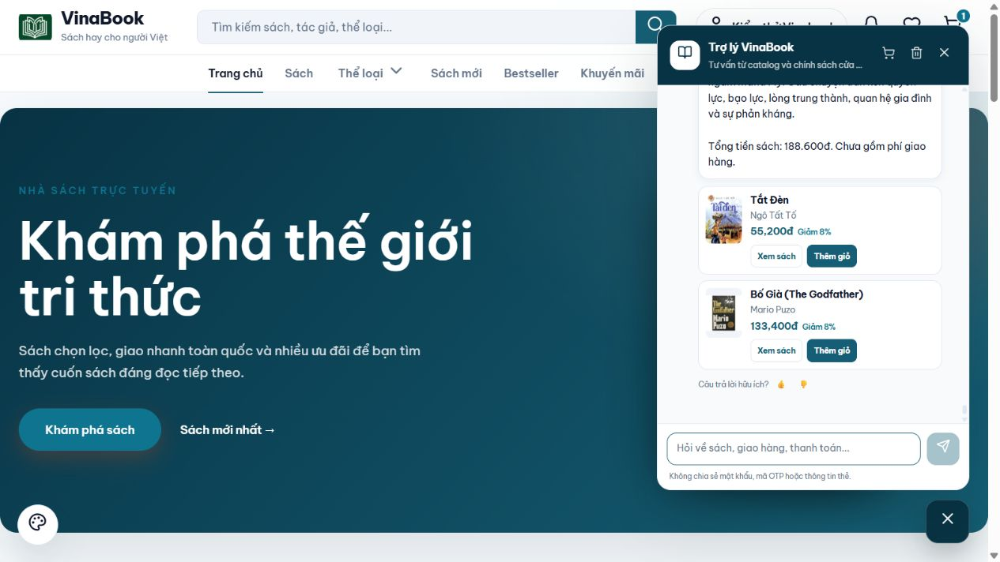

# Hoàn thiện tư vấn sách — 08/10/2026

Năm cải thiện được triển khai lần lượt, kiểm tra trên chatbot sau từng bước: giữ ngữ cảnh; phân biệt dạng tác phẩm; kiểm tra điều kiện bắt buộc; mở rộng chủ đề theo lựa chọn của khách; giải thích bằng dữ kiện đã xác nhận.

## Hành vi sau sửa

- Siết điều kiện hoặc cập nhật giá giữ nhu cầu đang tìm. Đổi nhu cầu rõ ràng bỏ loại trừ cũ; bỏ loại trừ không bị chính câu nói tham chiếu điều kiện cũ thêm lại. Điều kiện loại trừ mới trong cùng lượt vẫn được nhận. Mức đọc/người nhận không tự mang sang một nhu cầu mới không nhắc đến họ.
- Tiểu thuyết, truyện ngắn, truyện tranh được kiểm tra từ tên và nội dung đã xác nhận; danh mục rộng không đủ chứng minh dạng tác phẩm. Không đoán loại của sách chỉ có mô tả chung.
- Điều kiện từ lời khách được kiểm tra ngoài query do planner điền. Câu phủ định về lập trình hoặc mức đọc không được dùng làm bằng chứng phù hợp. “Không quá 200k” không làm mất yêu cầu “3 cuốn”.
- Tìm sách đúng trước; số cuốn yêu cầu không tự cho phép thêm sách gần chủ đề. Khi thiếu/hết, đề nghị mở rộng; “Có” chỉ mở rộng khi đang có đề nghị đó. Nhóm mở rộng vẫn giữ dạng sách, giá, rating, tồn kho, loại trừ và không lặp sách đã giới thiệu. Chỉ chung tag truyện tranh không đủ gợi ý Doraemon cho trinh thám.
- Mỗi gợi ý trình bày nội dung, lý do gắn với chủ đề, mức giá nếu đã nêu và dữ kiện chưa xác nhận. Mô tả dài hơn giữ các giới hạn thư mục quan trọng; không khẳng định sách dễ đọc/hợp người mới khi thiếu hồ sơ. Nhu cầu nhẹ nhàng và dễ đọc được xét cùng nhau; ưu tiên bằng chứng có thật và nói rõ phần thiếu.

## Xác minh

259 kiểm thử backend đạt: ChatToolsTest 180, ChatServiceTest 59, ChatRecommendationIntakeTest 20; không failure/error. Build/test dùng output riêng, backend local được khởi động lại với các lớp chatbot đã biên dịch.

12 ca cuối dưới đây được nhập/gửi qua giao diện chatbot tại localhost:4200 sau bản sửa cuối. Phản hồi hoàn tất và thẻ sách được đọc trực tiếp; API catalog chỉ phục vụ đối chiếu dữ kiện, không dùng API chat thay cho UI. Trước đó có kiểm tra đối chiếu mở rộng trên phiên khách 127.0.0.1:4200. Không thêm giỏ, tạo đơn, xóa lịch sử hoặc sửa catalog trong QA. Console của lượt cuối không có error/warn.

| # | Câu nhập | Kết quả quan sát |
|---|---|---|
| 1 | Đổi sang gợi ý sách trinh thám dưới 150k | PASS — Conan 23.750đ; nêu đúng giá tối đa 150.000đ mỗi cuốn. |
| 2 | Chỉ lấy đúng sách trinh thám, không gợi ý sách gần chủ đề | PASS — Giữ mức 150k, chỉ Conan; không thêm Sherlock Holmes 193.500đ. |
| 3 | Còn cuốn nào khác không? | PASS — Không lặp sách đã giới thiệu, không tự bổ sung Doraemon; hỏi mở rộng. |
| 4 | Có | PASS — Hiểu đồng ý mở rộng, giữ giá và sách đã xem; chưa có lựa chọn đủ căn cứ trong phiên này. |
| 5 | Đổi sang sách lập trình Python, chỉ lấy Python, không lấy Java, mỗi cuốn dưới 200k | PASS — Không có sách Python trong catalog nên không trả sách khác thay thế. |
| 6 | Đổi sang gợi ý sách lập trình Java cho người mới, dưới 150k | PASS — Bỏ loại trừ Java của nhu cầu trước; Java 91.800đ. Nêu thiếu dữ liệu về mức đọc và mục lục. |
| 7 | Đổi sang gợi ý sách lập trình, không lấy Java, mỗi cuốn dưới 150k | PASS — Chỉ Giáo Trình Cấu Trúc Dữ Liệu Và Giải Thuật 83.600đ và Giáo Trình Cơ Sở Dữ Liệu 90.160đ; không AI phổ thông/Blockchain. |
| 8 | Bỏ điều kiện không lấy Java trước đó. Không lấy Python, chỉ gợi ý sách Java dưới 150k | PASS — Bỏ loại trừ Java, vẫn nhận loại trừ Python mới; trả Java 91.800đ. |
| 9 | Đổi nhu cầu: gợi ý 3 cuốn tiểu thuyết, tổng tiền cả 3 cuốn không quá 200k | PASS — Tắt Đèn + Bố Già = 188.600đ. Báo thiếu 1 cuốn, không dùng truyện tranh/truyện ngắn để bù. |
| 10 | Đổi sang gợi ý truyện nhẹ nhàng dễ đọc để thư giãn | PASS — Bỏ Số Đỏ; có Cho Tôi Xin Một Vé Đi Tuổi Thơ với căn cứ dễ đọc từ hồ sơ. Không mang người mới học Java sang. Ghi riêng mức độ nhẹ nhàng hoặc dễ đọc còn thiếu. |
| 11 | Gợi ý sách cho mẹ | PASS — Hỏi nhu cầu của mẹ; không dùng sở thích đọc trước đó để tự đề xuất. |
| 12 | Mẹ thích chăm sóc cây cảnh | PASS — Không tìm được sách cây cảnh; không bịa sản phẩm. |

PASS đánh giá hành vi trong ca tương ứng, không khẳng định mọi sách đã đủ thông tin. Ca đọc thư giãn còn ghi thiếu bằng chứng cho từng tiêu chí; không suy ra mọi lựa chọn đều nhẹ nhàng và dễ đọc. Live dùng provider **local**, chưa kiểm tra Gemini thật. Các quy tắc cưỡng chế và nhánh planner được kiểm tra bằng test tự động với AI giả lập.

[Phản hồi đầy đủ của 12 ca](results-ui-improvements-2026-10-08.json). [Báo cáo trước khi sửa](review-ui-recommendations-2026-10-08.md).
