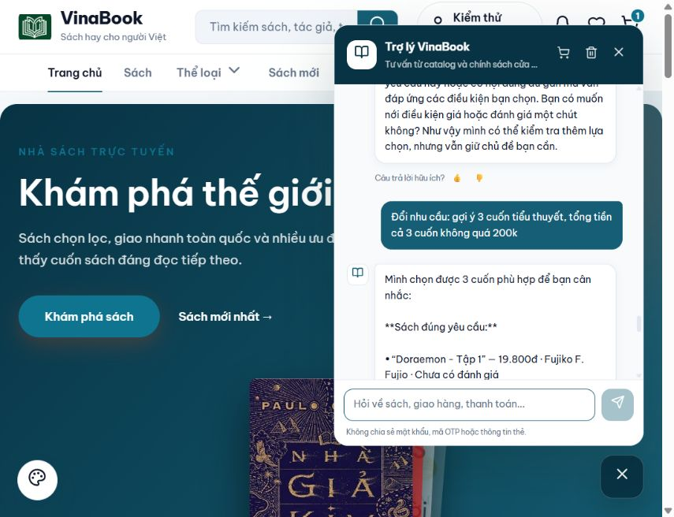

# Kiểm tra trực tiếp tư vấn sách — 08/10/2026

Kết luận: luồng bỏ bắt buộc người đọc đã hoạt động, nhưng chất lượng tư vấn chưa đạt ở một số ca đổi điều kiện và phân loại sách. 14 tình huống: 8 đạt, 5 chưa đạt và 1 cần xem thêm dữ liệu. Đây là kết quả của các tình huống trong bảng, không phải tỷ lệ đúng cho mọi câu hỏi.

## Cách kiểm tra

Nhập và gửi từng câu trực tiếp trong khung chatbot trên browser, đợi phản hồi hoàn tất rồi đọc văn bản cùng thẻ sách. Không dùng API chat để thay cho thao tác UI. Tài khoản kiểm thử tại localhost:4200 và phiên khách mới độc lập tại 127.0.0.1:4200 giúp đối chiếu ảnh hưởng của lịch sử. Backend đang chạy ở chế độ local; chưa kiểm tra Gemini thật. Không xóa cuộc trò chuyện cũ, tạo đơn, thêm giỏ hay thay đổi catalog.

API catalog công khai chỉ được đọc để đối chiếu dữ kiện sản phẩm. Không có sách Python; Giáo Trình Lập Trình Java đang bán giá gốc 102.000đ, giảm 10% còn 91.800đ; Sherlock Holmes giá gốc 215.000đ, giảm 10% còn 193.500đ. Console hai tab không có error/warn trong đợt này.

## Kết quả

| # | Câu nhập trên chatbot | Kết quả | Quan sát |
|---|---|---|---|
| 1 | Gợi ý sách dưới 150k | PASS | Chỉ hỏi chủ đề/mục đích, không hỏi người nhận, chưa trả sách. |
| 2 | trinh thám | PASS | Trả Conan 23.750đ ngay sau khi bổ sung chủ đề, giữ giới hạn 150k. |
| 3 | còn cuốn khác không? | FAIL | Không lặp Conan nhưng gợi ý Doraemon cho trinh thám chỉ vì cùng truyện tranh; căn cứ quá rộng. |
| 4 | Chỉ lấy đúng sách trinh thám, không gợi ý sách gần chủ đề | FAIL | Chọn đúng trinh thám nhưng mất mức 150k trước đó: Sherlock Holmes 193.500đ xuất hiện. |
| 5 | Đổi sang sách lập trình Python, chỉ lấy Python, không lấy Java, mỗi cuốn dưới 200k | PASS | Không bịa sách Python hoặc thay bằng Java; catalog thực tế không có sách Python. |
| 6 | Tăng lên 350k mỗi cuốn, vẫn chỉ lấy Python và không lấy Java | PASS | Tăng giới hạn vẫn không bịa sách Python khi catalog không có. |
| 7 | Đổi sang gợi ý sách lập trình Java cho người mới, dưới 150k | FAIL | Đổi sang Java nhưng bỏ sót Giáo Trình Lập Trình Java 91.800đ; trả 5 sách AI/Blockchain/cơ sở dữ liệu gần chủ đề. |
| 8 | Bỏ điều kiện không lấy Java trước đó. Chỉ gợi ý sách Java dưới 150k | FAIL | Nói rõ bỏ điều kiện loại Java vẫn không nhận được sách Java. Ở phiên mới cùng yêu cầu có kết quả đúng. |
| 9 | Đổi nhu cầu: gợi ý 3 cuốn tiểu thuyết, tổng tiền cả 3 cuốn không quá 200k | FAIL | Đủ 3 sách, tổng 93.050đ đúng, nhưng cả Doraemon, Conan và Chí Phèo đều không phải tiểu thuyết theo yêu cầu. |
| 10 | Gợi ý sách lập trình Java cho người mới, dưới 150k | PASS | Phiên khách mới trả Giáo Trình Lập Trình Java 91.800đ, không hỏi người nhận; nêu giới hạn dữ liệu mục lục. |
| 11 | Đổi sang gợi ý truyện nhẹ nhàng dễ đọc để thư giãn | REVIEW | Có ghi chú chưa xác nhận độ dễ đọc; lựa chọn Số Đỏ và Đường Xưa Mây Trắng cần căn cứ rõ hơn cho nhu cầu nhẹ nhàng, dễ đọc. |
| 12 | Gợi ý truyện cho bé 8 tuổi, dưới 150k | PASS | Giữ giá dưới 150k, có ghi chú thiếu xác nhận tuổi cho các cuốn liên quan, không hỏi lại người nhận. |
| 13 | Gợi ý sách cho mẹ | PASS | Đổi sang mẹ thì hỏi nhu cầu, không dùng sở thích của bé để tự đề xuất. |
| 14 | Mẹ thích chăm sóc cây cảnh | PASS | Không có sách chăm sóc cây cảnh phù hợp: nói rõ chưa tìm được, không bịa sách. |

## Các vấn đề cần xử lý

1. Phân biệt chính xác tiểu thuyết, truyện ngắn và truyện tranh thay vì coi danh mục chung là đủ căn cứ. Ca 9 hiện gắn nhãn “Sách đúng yêu cầu” cho ba lựa chọn sai loại.
2. Giữ ngân sách khi khách chỉ làm chặt điều kiện chủ đề. Ca 4 làm mất mức 150k đã nêu trong ca 1–2.
3. Xử lý đổi nhu cầu và bỏ điều kiện loại trừ. Ca 7–8 không đưa sách Java trong phiên đã loại Java; ca 10 ở phiên mới trả đúng. Quan sát xác nhận ảnh hưởng ngữ cảnh; chưa kết luận nguyên nhân cụ thể trong code.
4. Siết căn cứ bổ sung sách gần chủ đề. Cùng là truyện tranh không đủ để đưa Doraemon vào gợi ý trinh thám; nhắc từ “lập trình” trong mô tả cũng chưa đủ để đáp ứng nhu cầu học Java.

Trường hợp đọc nhẹ nhàng/dễ đọc có cảnh báo thiếu dữ liệu, nhưng cần rà mức phù hợp và thứ tự ưu tiên khi còn ít bằng chứng. Kết quả tuổi đọc ở ca 12 không phải xác nhận mọi cuốn phù hợp chính xác cho bé 8 tuổi.

Phản hồi thực tế đầy đủ được lưu trong [JSON 14 tình huống](results-ui-recommendations-2026-10-08.json). Lượt này kiểm tra và ghi nhận lỗi; các vấn đề trên còn tồn tại.

## Sau khắc phục cùng ngày

Báo cáo phía trên giữ lại kết quả trước khi sửa. Các lỗi ngân sách, loại trừ, dạng tác phẩm, mở rộng và đọc thư giãn đã được xử lý, kiểm tra lại qua 12 ca UI local và 259 test backend. Xem [bản sau sửa](recommendation-improvements-2026-10-08.md); phần thiếu dữ liệu của từng sách vẫn được nêu rõ.
