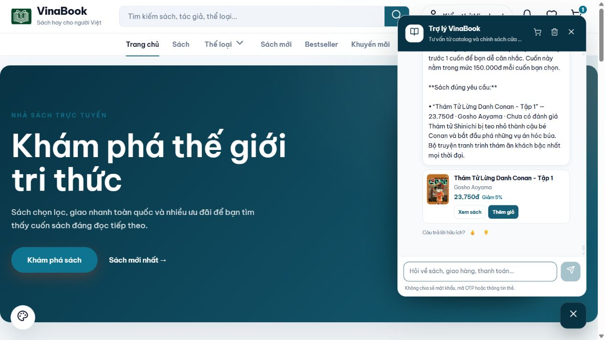

# Danh sách gọn và lời tư vấn — 09/10/2026

## Thay đổi

1. Mặc định tối đa 3 cuốn. Yêu cầu số lượng cụ thể, giới hạn số lượng và “tất cả” giữ đúng theo lời khách. Với yêu cầu thư giãn hoặc nhiều tiêu chí đọc, chọn nhóm có nhiều tiêu chí đã được xác nhận nhất, không cố bù đủ 3. Lượt “còn cuốn nào khác” loại sách đã giới thiệu trước khi chọn nhóm tiếp theo. Không nới điều kiện bắt buộc, giá, tổng ngân sách hay dạng tác phẩm.
2. Lời dẫn nối với nhu cầu hiện tại, giới hạn giá nhắc một lần. Mỗi cuốn dùng mô tả nội dung riêng, phần giọng kể/độ dễ đọc/cách áp dụng lấy đúng trường đã duyệt. Không lặp câu “mình chọn cuốn này dựa trên nội dung đã được xác nhận” hoặc “hồ sơ ghi”. Vẫn giữ thông tin chưa xác nhận và đề nghị xem mục lục/đọc thử khi chưa đủ căn cứ về người mới.
3. Ca không có sách đúng ngôn ngữ lập trình giải thích rằng tăng ngân sách chưa giải quyết được việc thiếu nội dung. Không đưa gợi ý nới giá một cách máy móc.

Người nhận và ngân sách vẫn tùy chọn; có nhu cầu đọc rõ thì tư vấn ngay. Không tạo đơn, sửa giỏ hàng, xóa lịch sử hoặc push GitHub trong lượt này.

## Kiểm tra backend

266 test đạt: ChatToolsTest 187, ChatServiceTest 59 và ChatRecommendationIntakeTest 20. Bao gồm các ca số lượng cụ thể 9 cuốn, “tất cả”, tối đa 4 cuốn; chỉ có một sách đáp ứng đủ các mong muốn thì không bù bằng sách thiếu căn cứ; hỏi thêm chuyển sang sách chưa giới thiệu; giữ tổng ngân sách; dùng đúng trường bằng chứng; không đề nghị nới giá khi không có nội dung bắt buộc.

## Kiểm tra trực tiếp qua chatbot

Chạy lần lượt trên UI http://localhost:4200/, sau mỗi phần mới chuyển sang phần tiếp theo. 9 quan sát đạt ở bản sửa tương ứng. Một câu trả lời chưa hợp lý được phát hiện trong lúc thử, sửa và thử lại thành công. Không có lỗi/cảnh báo console ở lần quan sát cuối.

| Phần | Yêu cầu | Kết quả |
|---|---|---|
| Chọn sách | Truyện nhẹ nhàng, dễ đọc | 3 cuốn, ghi rõ phần chưa xác nhận |
| Chọn sách | 5 tiểu thuyết, mỗi cuốn dưới 150k | Giữ yêu cầu 5; chỉ có 2 đúng điều kiện thì báo thiếu |
| Chọn sách | 3 tiểu thuyết, tổng dưới 200k | Tắt Đèn + Bố Già, 188.600đ; báo thiếu 1 |
| Lời tư vấn | Java cho người mới, dưới 150k | 1 sách 91.800đ; giữ giới hạn về mục lục, phiên bản, độ khó |
| Lời tư vấn | Đổi sang truyện thư giãn dễ đọc | 3 sách; giải thích giọng kể hoặc độ dễ đọc theo bằng chứng; bỏ cảnh báo người mới cũ |
| Lời tư vấn | Trinh thám dưới 150k | Conan 23.750đ; giới hạn giá nhắc một lần |
| Lời tư vấn | Chỉ Python dưới 200k | Không bịa sách; sau sửa giải thích tăng giá chưa giúp |
| Lời tư vấn | Đổi sang 3 tiểu thuyết, tổng dưới 200k | Giữ tổng 188.600đ và thiếu 1; mô tả riêng cho từng sách |
| Lời tư vấn | Chỉ trinh thám dưới 150k, bản cuối | Conan; lời dẫn và ghi chú giá đã chỉnh; nút Xem sách/Thêm giỏ vẫn hiện |

Chi tiết câu hỏi, câu trả lời và tiêu chí nằm trong [JSON](results-ui-shortlist-2026-10-09.json). Ảnh minh chứng:

## Giới hạn

Runtime dùng provider local; chưa kiểm tra Gemini thật. Đây là kiểm tra hồi quy theo các kịch bản trên, không phải điểm đánh giá toàn bộ chất lượng tư vấn. Một số sách thư giãn mới có bằng chứng cho một tiêu chí, nên chatbot vẫn phải nói rõ phần chưa đủ thông tin. Chất lượng còn phụ thuộc độ đầy đủ của nội dung đã duyệt trong catalog.
