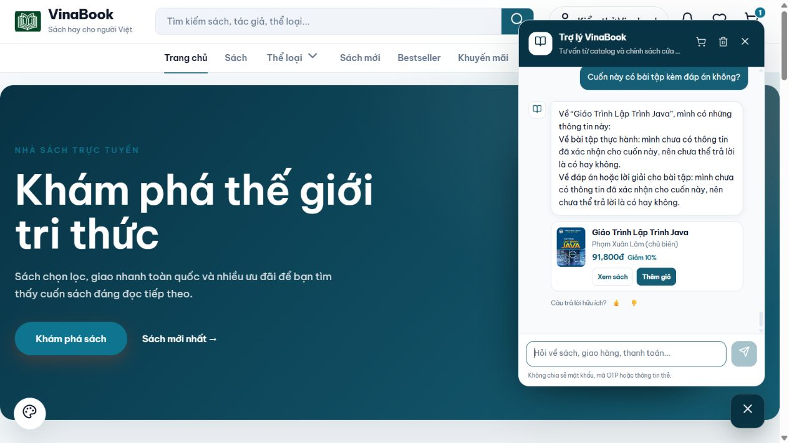

# Thử nghiệm nhãn cho 20 sách — 10/10/2026

## Kết quả và phạm vi

Đã áp dụng local **154 nhãn mới cho đúng 20 sách**, dùng hồ sơ AI và các bảng chủ đề hiện có. Không mở rộng sang 36 sách còn lại. Mỗi cuốn có 6–9 nhãn mới trong bảy nhóm: thể loại, chủ đề, mục đích, dạng nội dung, độc giả, cách trình bày, mức đọc. Chỉ gắn nhóm nào có căn cứ.

- [Danh sách nhãn dễ đọc](../book-knowledge/labels-20-2026-10-10.md)
- [Manifest có căn cứ cho từng nhãn](../book-knowledge/labels-20-2026-10-10.json)
- [Kế hoạch và tiêu chí](../book-knowledge/label-pilot-plan-2026-10-10.md)

Nhãn được biên tập từ hồ sơ đã duyệt, có tên trường, nguyên văn căn cứ và URL nguồn. Dùng lại nguồn đã đối chiếu ngày 05/10; đợt này chưa đọc lại toàn bộ nguồn hoặc xác minh từng ấn bản. Từ tiếng Anh là ánh xạ đồng nghĩa phục vụ truy xuất. Những thông tin chưa biết và giới hạn lưu riêng trong manifest, không nhập thành từ khóa.

## A/B truy xuất có kiểm soát

Cố định cùng 20 sách, 30 câu hỏi và danh sách sách liên quan trước lần đo đầu. Dùng mã truy xuất Java thật với repository giả lập từ snapshot MySQL thật; cả hai nhánh tắt embedding và không gọi AI. Chỉ thêm nội dung nhãn vào chỉ mục. Phép đo này đánh giá **truy xuất trong mẫu 20 sách**, không phải tỷ lệ đúng của toàn chatbot hay toàn catalog.

| Nhóm | Vị trí đầu trước → sau | Trong 3 vị trí đầu trước → sau | MRR trước → sau |
|---|---:|---:|---:|
| Cách hỏi thông thường (20) | 19 → 19 | 20 → 20 | 0,975 → 0,975 |
| Đồng nghĩa/cách gọi khác (10) | 1 → 8 | 2 → 10 | 0,170 → 0,883 |
| Tổng (30) | **20 → 27** | **22 → 30** | **0,707 → 0,944** |

Không có câu nào đang đúng ở vị trí đầu trở thành sai trong kết quả cuối. Bộ câu hỏi được xây có chủ đích theo nhãn, chưa phải một tập đánh giá độc lập đại diện người dùng thực tế.

[Toàn bộ truy vấn, sách kỳ vọng và thứ hạng trước/sau](labels-20-ab-2026-10-10.json).

### Lỗi đã phát hiện và sửa trong thử nghiệm

Lần đầu, tiền tố nhóm như “Thể loại:” bị đưa vào chỉ mục, khiến từ phổ biến “loại” gây nhiễu: Harry Potter đứng trước Dế Mèn ở câu “truyện phiêu lưu loài vật”. Đã sửa `BookKnowledgeService` để chỉ lập chỉ mục phần giá trị của bảy nhóm nhãn, giữ tên đầy đủ trong admin; nhãn cũ không có tiền tố vẫn dùng như trước. Công cụ nhập cũng chỉ thêm giá trị nhãn. Chạy lại bộ A/B và kiểm tra hồi quy sau sửa, kết quả cuối ở bảng trên.

### Ba trường hợp còn xếp vị trí đầu chưa tốt

| Câu hỏi | Sách đứng đầu sau nhập | Sách được chấp nhận trong bộ đánh giá |
|---|---|---|
| “ký ức tuổi thơ người lớn” (Q16) | Hoàng Tử Bé | Cây Cam Ngọt Của Tôi; Totto-Chan; Cho Tôi Xin Một Vé Đi Tuổi Thơ |
| “hồi ức tuổi thơ” (Q29) | Hoàng Tử Bé | Ba cuốn trên |
| “truyện động vật” (Q30) | Conan Tập 1 | Dế Mèn Phiêu Lưu Ký |

Sách được kỳ vọng đều có trong ba kết quả đầu sau nhập. Các từ chung vẫn có thể lấn chủ đề chính khi chấm điểm văn bản phẳng. Vì vậy kết quả 30/30 trong Top 3 chưa đủ để kết luận chatbot chọn đúng cuốn đầu tiên cho mọi nhu cầu.

## Kiểm thử và bảo toàn dữ liệu

- **62 kiểm thử Java đạt**: 10 `BookKnowledgeServiceTest`, 3 `BookLabelPilotEvaluationTest`, 7 `ChatExplicitFiltersTest`, 42 `ChatStructuredPipelineTest`; không lỗi, không bỏ qua.
- **11 kiểm thử Python đạt** cho nhập nhãn: đúng phạm vi, định danh, trạng thái duyệt, căn cứ nguyên văn, nguồn, nhãn trùng, chạy lại, giới hạn các trường ghi và điều kiện khôi phục.
- Kiểm tra riêng: giao tiếp không lấy truyện/sách giảm lo âu; quản lý chi tiêu không lấy sách đầu tư; truyện tranh trinh thám không lấy truyện chữ Sherlock; không nhận Java thành Python/Spring Boot; giữ trần giá theo giá sau giảm; nhu cầu nhẹ nhàng loại Bố Già; Java chưa xác nhận độ khó/bài tập/đáp án.
- MySQL: đúng **20 hồ sơ/154 liên kết mới**. **36 sách ngoài mẫu không đổi**. Tên, tác giả, giá, tồn kho, giảm giá, số đã bán và nội dung đã duyệt của cả 56 sách giữ nguyên. Chỉ mục tìm kiếm sau nhập khớp dữ liệu A/B.
- Chạy công cụ lần nữa: **0 sách, 0 nhãn cần thay đổi**. Backup trước nhập lưu ngoài Git trong workspace. Công cụ có khôi phục có điều kiện; đã kiểm tra câu lệnh/điều kiện bằng unit test, chưa thực hiện khôi phục DB.

[Đối chiếu phạm vi thay đổi MySQL](labels-20-db-verification-2026-10-10.json).

## Thử trực tiếp chatbot

Đã gửi **8 lượt qua giao diện thật** ở localhost:4200, trong một phiên QA hiện có, bật catalog đầy đủ và Gemini. Hai lượt trước nhập, sáu lượt sau nhập (gồm một lỗi dịch vụ và một lần thử lại). Đây là quan sát định tính: không kiểm soát hoàn toàn lịch sử hội thoại, embedding, đầu ra AI; không dùng làm tỷ lệ A/B thống kê.

| Tình huống | Quan sát |
|---|---|
| `unit testing`, dưới 200k | Trước: không tìm được. Sau: **Clean Code**, 151.200đ, lý do có kiểm thử đơn vị. |
| `cognitive bias`, dưới 200k | Trước: không tìm được. Sau: **Tư Duy Nhanh Và Chậm**, 151.300đ, lý do về thiên kiến nhận thức. |
| Hai sách giao tiếp đồng nghiệp, mỗi cuốn dưới 150k, tổng dưới 200k | Chỉ đưa **Đắc Nhân Tâm**, 70.520đ; nói rõ chưa đủ hai sách khác nhau, không lấy truyện để lấp số lượng. |
| Giáo trình Java dưới 150k cho người mới | Lượt đầu chậm rồi báo chưa xử lý được. Backend có `invalid_response` và Gemini HTTP 503. Thử lại đúng một lần: **Giáo Trình Lập Trình Java**, 91.800đ; nêu rõ chưa xác nhận độ khó cho người mới. |
| Hỏi tiếp “Cuốn này có bài tập kèm đáp án không?” | Nhớ đúng giáo trình Java; cả bài tập và đáp án đều **chưa có thông tin đã xác nhận**, không tự suy đoán có/không. |

Điểm còn yếu ngoài truy xuất: một lượt dịch vụ AI thất bại; câu trả lời Java sau thử lại lặp ý lưu ý độ khó. Nhãn không tự giải quyết độ ổn định nhà cung cấp hoặc câu chữ của bộ viết câu trả lời. Các điểm này vẫn còn, không tính là đã sửa trong đợt gắn nhãn.

[Nguyên văn 8 lượt kiểm thử](labels-20-ui-2026-10-10.json).

## Đề xuất quyết định

**Nhãn có ích, nhất là cách gọi đồng nghĩa; nên giữ mẫu 20 cuốn để dùng thử. Chưa nên nhập hàng loạt ngay.** Bước tiếp theo nên ưu tiên chấm điểm theo chủ đề chính và nhóm nhãn, rồi đo bằng bộ câu hỏi mới chưa dùng để xây nhãn. Chỉ mở rộng sang toàn catalog khi người dùng chốt sau báo cáo này.
