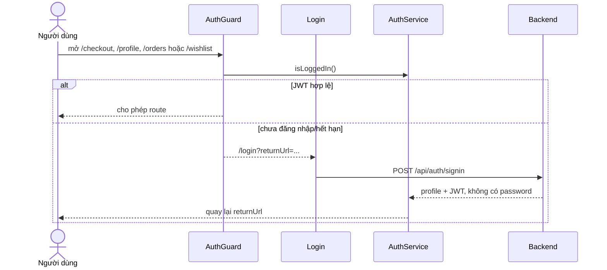
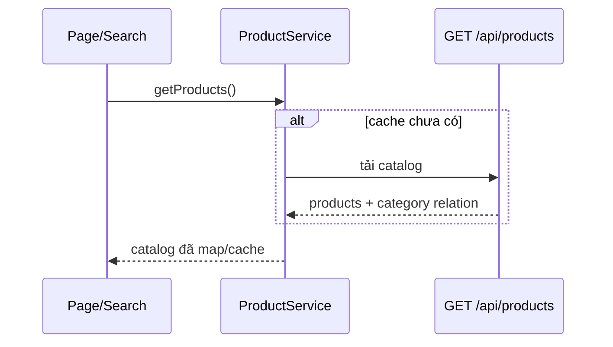
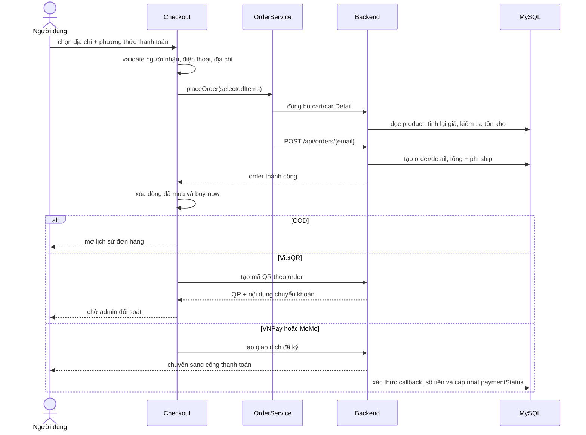

# Luồng nghiệp vụ chính

## Đăng nhập và route bảo vệ

## Catalog và tìm kiếm

Home, books, search, product detail, category và wishlist đều dựa trên nguồn này.

## Checkout

Backend không tin giá/owner do client gửi. Mức ship hiện là `20.000đ`, miễn phí từ `300.000đ`.

## Review

User đăng nhập chọn 1–5 sao và nhập bình luận. `ReviewService` POST hoặc PUT `/api/rates`; backend gắn review với user/product canonical và chỉ cho owner sửa. Sau thành công, `changes$` làm mới rating ở product card/detail/profile.
